# Fun AI Science

English · [中文](README.zh.md)

AI projects in science that you can open, run, or inspect: protein models, math search, weather models, lab agents, and AI "research teams". Each entry links to its paper and to the code, data, or tool you can try. Every number in a science entry is copied from the linked pages, read on 2026-11-15 and listed in [SOURCES_READ.tsv](SOURCES_READ.tsv). The GPT-6 Astra section is carried over from the earlier version and was not re-checked.

The repository name `awesome-astra-science` is left over from when this list covered GPT-6 Astra only. Those works remain here under [Model showcases](#model-showcases).

## How entries are chosen

- The project produced a verifiable scientific result: a structure, a proof, a forecast, a molecule, or a lab result.
- There is a primary source: the paper or the maker's own page.
- There is something to open: a repo, a database, a web tool, or an API.
- Each entry has one or two lines on what the AI did, using numbers from the source only, with no benchmark tables or news coverage.

## Contents

- [Proteins and DNA](#proteins-and-dna): 7
- [Math and algorithms](#math-and-algorithms): 3
- [Materials](#materials): 1
- [Weather and Earth](#weather-and-earth): 2
- [Chemistry agents](#chemistry-agents): 2
- [AI research teams](#ai-research-teams): 6
- [Model showcases](#model-showcases): GPT-6 Astra (OpenAI), 12 works
- [Adding entries](#adding-entries)

---

## Proteins and DNA

### AlphaFold 2 (Google DeepMind, 2021)
Predicts a protein's 3D structure from its amino-acid sequence. At CASP14 its accuracy was competitive with experimental structures in most cases.
- Paper: [Jumper et al., Nature 2021](https://www.nature.com/articles/s41586-021-03819-2)
- Open it: [AlphaFold Protein Structure Database](https://alphafold.ebi.ac.uk/), over 200 million predicted structures, free to browse and download

### AlphaFold 3 (Google DeepMind, 2024)
Predicts how proteins bind and assemble with nucleic acids, small molecules, ions, and modified residues, rather than single proteins alone.
- Paper: [Abramson et al., Nature 2024](https://www.nature.com/articles/s41586-024-07487-w)
- Open it: [AlphaFold Server](https://alphafoldserver.com/) (web tool)

### ESM3 (EvolutionaryScale, 2025)
A protein language model prompted to design new fluorescent proteins. One bright fluorescent protein it generated shares only 58% of its sequence with known fluorescent proteins, a gap the authors estimate at about 500 million years of evolution.
- Paper: [Hayes et al., Science 2025](https://doi.org/10.1126/science.ads0018)
- Code: [evolutionaryscale/esm](https://github.com/evolutionaryscale/esm) (now redirects to Biohub/esm)

### Evo 2 (Arc Institute and partners, 2025)
A DNA model trained on 9.3 trillion base pairs from all domains of life, processing up to 1 million bases at a time.
- Preprint: [Brixi et al., bioRxiv 2025](https://doi.org/10.1101/2025.02.18.638918)
- Code: [ArcInstitute/evo2](https://github.com/ArcInstitute/evo2)

### Whole phage genomes written by a genome model (2026)
Genome language models designed complete bacteriophage genomes using phage ΦX174 as a template, yielding 16 viable phages in lab tests.
- Paper: [Science 2026](https://doi.org/10.1126/science.aec2657)

### AlphaGenome (Google DeepMind, 2025/2026)
Reads 1 megabase of DNA, predicts thousands of genome tracks, and scores the effects of genetic variants. The API is free for non-commercial use.
- Paper: [Avsec et al., Nature 2026](https://doi.org/10.1038/s41586-025-10014-0) · preprint [bioRxiv 2025](https://doi.org/10.1101/2025.06.25.661532)
- API and code: [google-deepmind/alphagenome](https://github.com/google-deepmind/alphagenome)

### Nanobodies from a "Virtual Lab" (Stanford, 2025)
An AI "principal investigator" agent led a team of AI scientist agents. Using ESM, AlphaFold-Multimer, and Rosetta, they designed 92 new nanobodies against SARS-CoV-2 variants that were then tested in the lab.
- Paper: [Swanson et al., Nature 2025](https://www.nature.com/articles/s41586-025-09442-9)
- Code: [zou-group/virtual-lab](https://github.com/zou-group/virtual-lab)

## Math and algorithms

### FunSearch (Google DeepMind, 2023)
An LLM writes candidate programs while an evaluator keeps the best ones. It discovered larger cap sets than previously known and new heuristics for online bin packing.
- Paper: [Romera-Paredes et al., Nature 2023](https://www.nature.com/articles/s41586-023-06924-6)
- Code: [google-deepmind/funsearch](https://github.com/google-deepmind/funsearch)

### AlphaEvolve (Google DeepMind, 2025)
A coding agent that evolves programs. It multiplied two 4×4 complex matrices using 48 scalar multiplications, raised the lower bound for the 11-dimensional kissing number to 593, and wrote a scheduling heuristic that recovers an average of 0.7% of Google's fleet-wide compute.
- Paper: [Novikov et al., arXiv 2506.13131](https://arxiv.org/abs/2506.13131)
- Check the results yourself: [google-deepmind/alphaevolve_results](https://github.com/google-deepmind/alphaevolve_results) (a Colab notebook that verifies each result)

### AlphaGeometry (Google DeepMind, 2024)
Solved 25 of 30 recent olympiad geometry problems, compared with 10 for the previous best method.
- Paper: [Trinh et al., Nature 2024](https://www.nature.com/articles/s41586-023-06747-5)
- Code: [google-deepmind/alphageometry](https://github.com/google-deepmind/alphageometry)

## Materials

### GNoME (Google DeepMind, 2023)
Graph networks identified 2.2 million crystal structures that are stable relative to earlier data, 736 of which had already been synthesized independently in labs.
- Paper: [Merchant et al., Nature 2023](https://www.nature.com/articles/s41586-023-06735-9)
- Data and Colabs: [google-deepmind/materials_discovery](https://github.com/google-deepmind/materials_discovery)

## Weather and Earth

### GraphCast (Google DeepMind, 2023)
Forecasts hundreds of weather variables 10 days ahead at 0.25° global resolution in under a minute, outperforming the most accurate operational deterministic systems on 90% of 1380 targets.
- Paper: [Lam et al., Science 2023](https://doi.org/10.1126/science.adi2336)
- Code: [google-deepmind/graphcast](https://github.com/google-deepmind/graphcast) (now the WeatherNext repo, which still includes GraphCast)

### Aurora (Microsoft, 2025)
An Earth-system model trained on more than a million hours of geophysical data. It forecasts air quality, ocean waves, tropical cyclone tracks, and high-resolution weather.
- Paper: [Bodnar et al., Nature 2025](https://www.nature.com/articles/s41586-025-09005-y)
- Code: [microsoft/aurora](https://github.com/microsoft/aurora)

## Chemistry agents

### Coscientist (Carnegie Mellon, 2023)
A GPT-4-based agent that plans and executes chemistry experiments on lab hardware, including optimizing palladium-catalyzed cross-coupling reactions.
- Paper: [Boiko et al., Nature 2023](https://www.nature.com/articles/s41586-023-06792-0)
- Code: [gomesgroup/coscientist](https://github.com/gomesgroup/coscientist)

### ChemCrow (EPFL and Rochester, 2023/2024)
An LLM agent equipped with 18 chemistry tools. It planned and carried out the synthesis of an insect repellent and three organocatalysts.
- Paper: [Bran et al., Nature Machine Intelligence 2024](https://www.nature.com/articles/s42256-024-00832-8) · preprint [arXiv 2304.05376](https://arxiv.org/abs/2304.05376)
- Code: [ur-whitelab/chemcrow-public](https://github.com/ur-whitelab/chemcrow-public)

## AI research teams

### AI co-scientist (Google, 2025)
A multi-agent system built on Gemini 2.0 that generates research hypotheses. Some of its drug-repurposing ideas for acute myeloid leukemia were confirmed in vitro.
- Paper: [arXiv 2502.18864](https://arxiv.org/abs/2502.18864) · [Google Research blog](https://research.google/blog/accelerating-scientific-breakthroughs-with-an-ai-co-scientist/)

### Robin (2025)
A multi-agent system that proposed ripasudil, a ROCK inhibitor already in clinical use, as a candidate treatment for dry age-related macular degeneration.
- Paper: [arXiv 2505.13400](https://arxiv.org/abs/2505.13400)
- Code: [Future-House/robin](https://github.com/Future-House/robin)

### Kosmos (2025)
Runs for up to 12 hours on a given dataset and goal, executing about 42,000 lines of code and reading about 1,500 papers per run. Independent scientists judged 79.4% of the statements in its reports to be accurate.
- Paper: [arXiv 2511.02824](https://arxiv.org/abs/2511.02824)

### The AI Scientist (Sakana AI, 2024)
Automates the workflow from idea to code, experiments, and a full machine-learning paper for less than $15 per paper.
- Paper: [Lu et al., arXiv 2408.06292](https://arxiv.org/abs/2408.06292)
- Code: [SakanaAI/AI-Scientist](https://github.com/SakanaAI/AI-Scientist)

### The AI Scientist-v2 (Sakana AI, 2025)
Submitted three fully AI-written papers to a peer-reviewed ICLR workshop; one scored above the average human acceptance threshold.
- Paper: [Yamada et al., arXiv 2504.08066](https://arxiv.org/abs/2504.08066)

### Agent Laboratory (2025)
Takes a human research idea through literature review, experiments, and report writing at 84% lower cost than earlier autonomous research methods.
- Paper: [Schmidgall et al., arXiv 2501.04227](https://arxiv.org/abs/2501.04227)
- Code: [SamuelSchmidgall/AgentLaboratory](https://github.com/SamuelSchmidgall/AgentLaboratory)

---

## Model showcases

Works that one model made by itself, shown with stills from [`media/`](media/) and linked to the maker's own pages. Stills are video frames or official assets; copyright stays with the original authors (see [NOTICE](NOTICE.md)).

### GPT-6 Astra (OpenAI)

Only projects GPT-6 Astra itself produced: official OpenAI demos and write-ups where Astra builds an artifact.

Source of truth: [GPT-6 Astra launch](https://openai.com/index/gpt-6-astra/) and linked OpenAI posts.

#### Computer-use demos (launch page)

##### Cell-tracking workflow (Jupyter)

<a href="https://openai.com/index/gpt-6-astra/">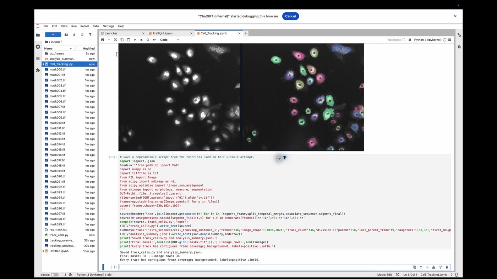</a>

Source: OpenAI · [launch · Cell-tracking workflow](https://openai.com/index/gpt-6-astra/)

Astra builds and runs a microscopy cell-tracking workflow in JupyterLab (masks → tracks / lineage). Condensed official computer-use demo, not a journal paper.

##### KiCad PCB (`chip_design`)

<a href="https://openai.com/index/gpt-6-astra/">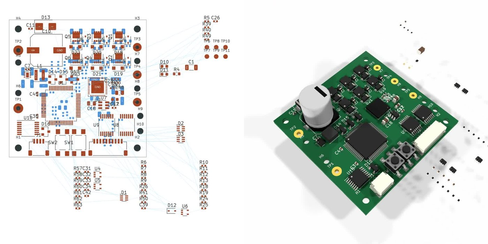</a>

Source: OpenAI · [launch](https://openai.com/index/gpt-6-astra/) · video `chip_design_no_captions_15s.mp4`

Astra places components and routes a manufacturable PCB in KiCad (2D layout + 3D board). This is the launch electronics desk, not MultiQC / sequencing QC.

##### FreeCAD five-speed transmission

<a href="https://openai.com/index/gpt-6-astra/">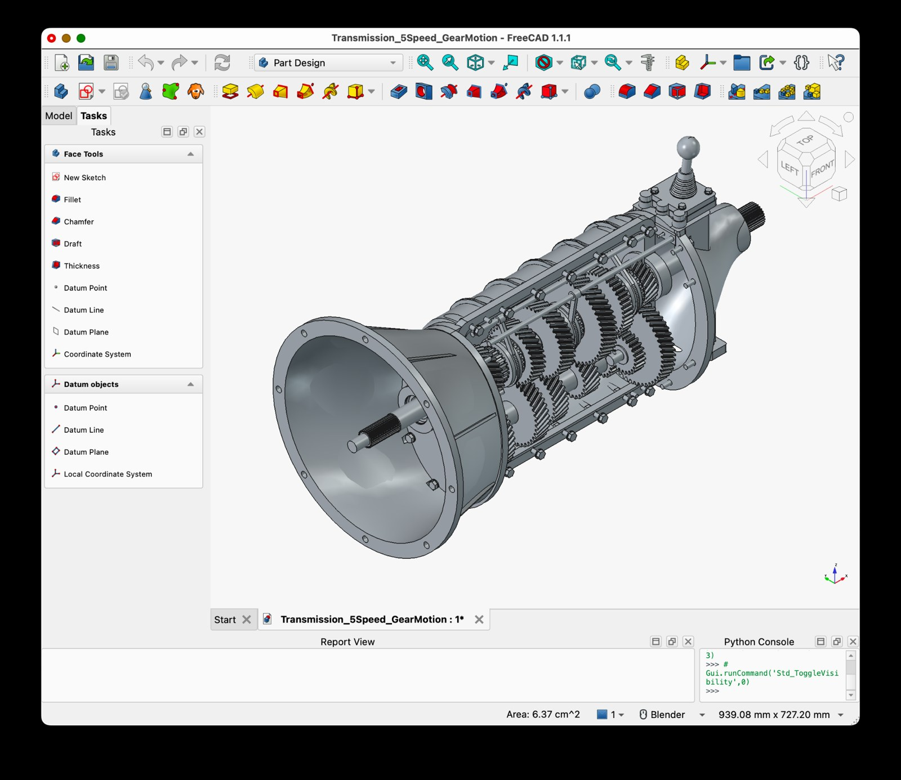</a>

Source: OpenAI · [launch · Car transmission](https://openai.com/index/gpt-6-astra/)

Written brief → detailed five-speed transmission concept in FreeCAD.

##### Gear motion (FreeCAD → Blender)

<a href="https://openai.com/index/gpt-6-astra/">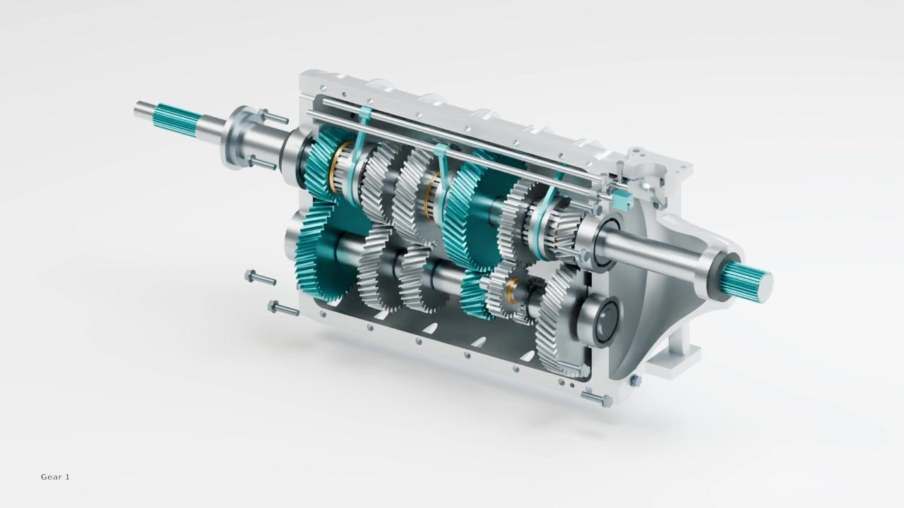</a>

Source: OpenAI · [launch](https://openai.com/index/gpt-6-astra/) · video `gear-motion.mp4`

Same transmission line: gears animated in motion (Blender follow-through on the FreeCAD design).

##### Unity city scene

<a href="https://openai.com/index/gpt-6-astra/">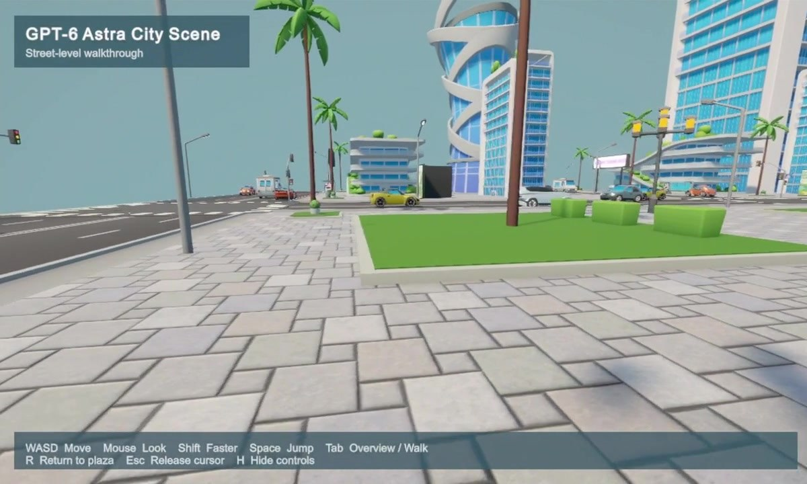</a>

Source: OpenAI · [launch](https://openai.com/index/gpt-6-astra/) · asset `Unity-City-high-res.png`

Aerial city scene assembled in Unity (official computer-use / game-assembly still).

#### 3D scenes and architectural visualization

##### Solace house (Blender → Unreal)

<a href="https://developers.openai.com/blog/architectural-visualization-with-astra">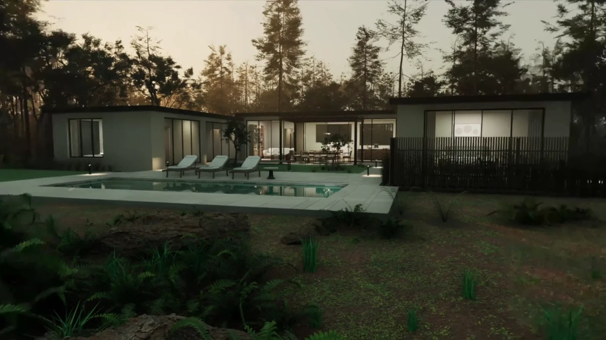</a>

<a href="https://developers.openai.com/blog/architectural-visualization-with-astra">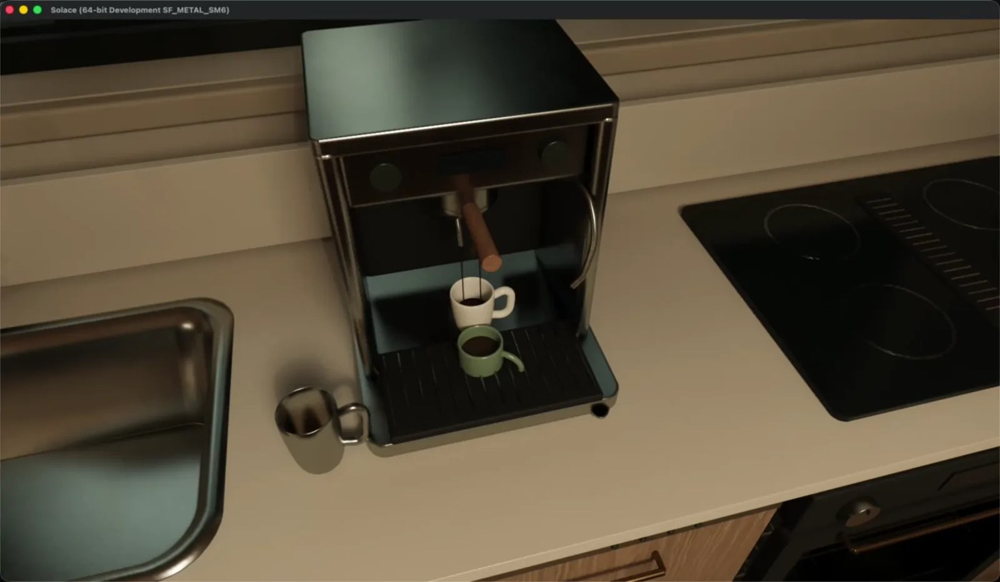</a>

Source: OpenAI Developers · [Architectural visualization with Astra](https://developers.openai.com/blog/architectural-visualization-with-astra)

Astra-driven arch-viz pipeline: research / modeling in Blender through to Unreal presentation (Solace).

##### HELIOS Dyson collector

<a href="https://developers.openai.com/blog/architectural-visualization-with-astra">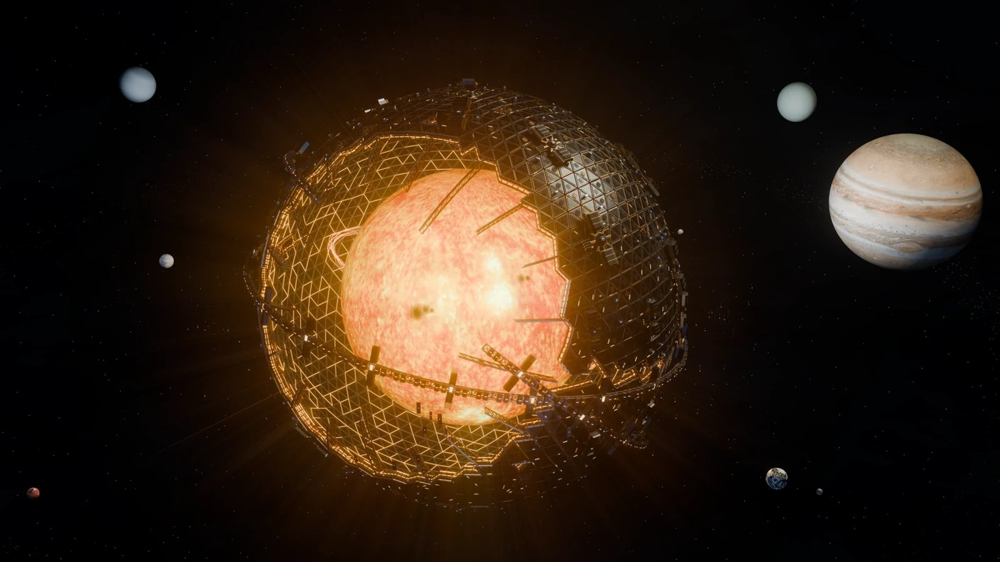</a>

Source: OpenAI Developers · same [architectural visualization](https://developers.openai.com/blog/architectural-visualization-with-astra) post

Concept build in the same official arch-viz write-up (HELIOS / Dyson-style collector).

##### Shipyard · AURELION-07 cruiser

<a href="https://developers.openai.com/blog/architectural-visualization-with-astra">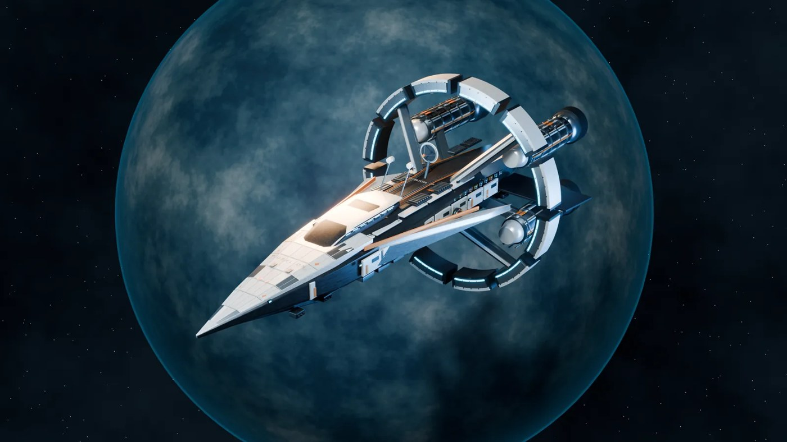</a>

Source: OpenAI Developers · [Architectural visualization with Astra](https://developers.openai.com/blog/architectural-visualization-with-astra)

Astra builds AURELION-07 in Blender (Shipyard project): tapered hull, segmented ring, four drives, all with editable geometry and materials.

##### Giverny water garden

Source: OpenAI Developers · [Architectural visualization with Astra](https://developers.openai.com/blog/architectural-visualization-with-astra)

Astra builds a Monet/Giverny-inspired garden scene (lily pond, bridge, planting) in the same official arch-viz write-up.

#### Games

##### Void Explorer ship (Blender)

<a href="https://developers.openai.com/blog/how-to-build-games-with-astra">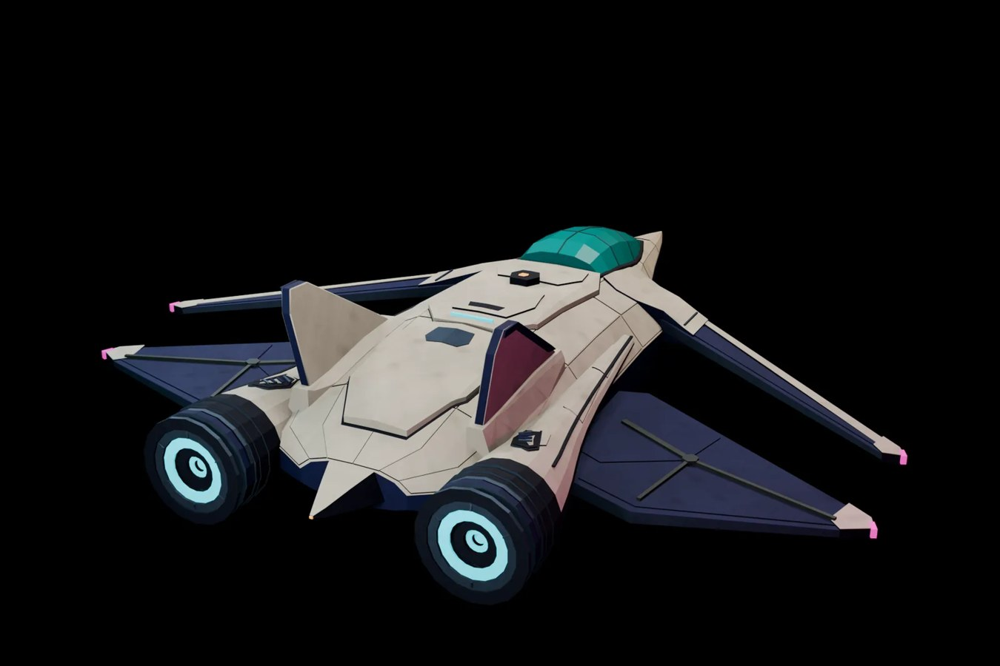</a>

Source: OpenAI Developers · [Building games with Astra](https://developers.openai.com/blog/how-to-build-games-with-astra)

Astra builds an editable Blender ship (AURORA: 193 meshes → runtime asset) for the Void Explorer game.

##### Sunwake ocean + boat

<a href="https://developers.openai.com/blog/how-to-build-games-with-astra">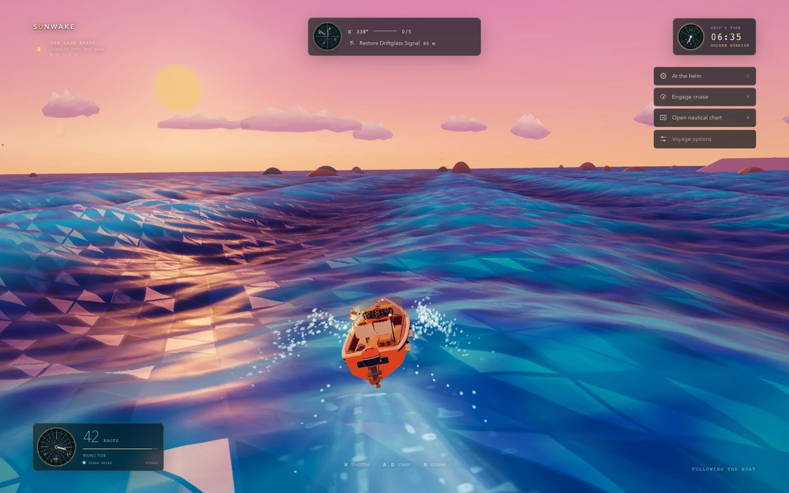</a>

Source: OpenAI Developers · same [games](https://developers.openai.com/blog/how-to-build-games-with-astra) post

Astra builds a custom Three.js water renderer and a Blender boat brought into Sunwake.

##### Hollowflux water RPG

<a href="https://developers.openai.com/blog/how-to-build-games-with-astra">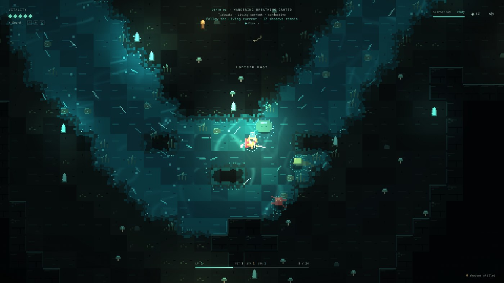</a>

Source: OpenAI Developers · [Building games with Astra](https://developers.openai.com/blog/how-to-build-games-with-astra)

Astra iterates a code-drawn 2D action RPG around a simulated underground river (water grid, currents, combat coupling).

#### Astra: out of scope

Removed or never listed:

- Third-party X / blog "I used Astra to…" demos
- Benchmark tables (GeneBench, OSWorld, EEBench, …): scores, not projects
- Journalism / "reality check" rooms
- Wrong MultiQC attribution (never an Astra-built project; the launch electronics desk is KiCad)
- Ten Lean math essay (OpenAI text says internal Astra, not clearly public GPT-6 Astra builds)

Broader Astra link dump: [helloianneo/awesome-gpt6-astra](https://github.com/helloianneo/awesome-gpt6-astra).

---

## Adding entries

See [CONTRIBUTING.md](CONTRIBUTING.md). To add a project, provide a primary source you have read, something people can open, one or two lines with numbers taken from that source, the same entry in both READMEs, and a row in [SOURCES_READ.tsv](SOURCES_READ.tsv) for every page used.

---

**Curator:** [Xuzhen Li](https://github.com/Xuzhen-Li) · [ORCID](https://orcid.org/0000-0003-3670-6657) · Editorial text under [CC0 1.0](LICENSE); see [NOTICE](NOTICE.md).
