# Fun AI Science（好玩的 AI 科学项目）

[English](README.md) · 中文

能打开、能运行、能看到结果的 AI 科学项目：蛋白质模型、数学搜索、天气模型、实验室智能体，还有 AI「科研团队」。每条都链接到论文，以及可以动手试的代码、数据或工具。科学条目里的数字都抄自 2026-11-15 读过的链接页面，列在 [SOURCES_READ.tsv](SOURCES_READ.tsv)。GPT-6 Astra 部分沿用旧版，未重新核对。

仓库名 `awesome-astra-science` 是只收 GPT-6 Astra 时留下的。那些作品还在，放在 [模型作品展示](#模型作品展示)。

## 收录标准

- 项目在科学上做成了一件可以核对的事：一个结构、一个证明、一次预报、一个分子、一个实验结果。
- 有一手来源：论文，或者作者自己的页面。
- 有能打开的东西：仓库、数据库、网页工具或 API。
- 用一两句话说 AI 做了什么，数字只取自来源。不收榜单表格，不收新闻报道。

## 目录

- [蛋白质与 DNA](#蛋白质与-dna)：7
- [数学与算法](#数学与算法)：3
- [材料](#材料)：1
- [天气与地球](#天气与地球)：2
- [化学智能体](#化学智能体)：2
- [AI 科研团队](#ai-科研团队)：6
- [模型作品展示](#模型作品展示)：GPT-6 Astra (OpenAI)，12 件
- [新增条目](#新增条目)

---

## 蛋白质与 DNA

### AlphaFold 2（Google DeepMind，2021）
由氨基酸序列预测蛋白质的三维结构。在 CASP14 中，多数情况下精度可与实验结构相当。
- 论文：[Jumper et al., Nature 2021](https://www.nature.com/articles/s41586-021-03819-2)
- 打开看看：[AlphaFold 蛋白质结构数据库](https://alphafold.ebi.ac.uk/)，超过 2 亿个预测结构，可免费浏览和下载

### AlphaFold 3（Google DeepMind，2024）
不只预测单个蛋白，还能预测蛋白质与核酸、小分子、离子和修饰残基怎样结合在一起。
- 论文：[Abramson et al., Nature 2024](https://www.nature.com/articles/s41586-024-07487-w)
- 打开看看：[AlphaFold Server](https://alphafoldserver.com/)（网页工具）

### ESM3（EvolutionaryScale，2025）
让蛋白质语言模型写新的荧光蛋白。其中一个很亮的荧光蛋白与已知荧光蛋白的序列相同度只有 58%，作者估计这相当于约 5 亿年的进化距离。
- 论文：[Hayes et al., Science 2025](https://doi.org/10.1126/science.ads0018)
- 代码：[evolutionaryscale/esm](https://github.com/evolutionaryscale/esm)（现在跳转到 Biohub/esm）

### Evo 2（Arc Institute 等，2025）
用来自所有生命域的 9.3 万亿个碱基对训练的 DNA 模型，一次最多读 100 万个碱基。
- 预印本：[Brixi et al., bioRxiv 2025](https://doi.org/10.1101/2025.02.18.638918)
- 代码：[ArcInstitute/evo2](https://github.com/ArcInstitute/evo2)

### 由基因组模型写出的完整噬菌体基因组（2026）
以噬菌体 ΦX174 为模板，用基因组语言模型设计完整的噬菌体基因组。实验得到 16 个能工作的噬菌体。
- 论文：[Science 2026](https://doi.org/10.1126/science.aec2657)

### AlphaGenome（Google DeepMind，2025/2026）
读入 1 Mb 的 DNA，预测上千条基因组功能轨迹，并评估一个变异会改变什么。API 对非商业用途免费。
- 论文：[Avsec et al., Nature 2026](https://doi.org/10.1038/s41586-025-10014-0) · 预印本 [bioRxiv 2025](https://doi.org/10.1101/2025.06.25.661532)
- API 与代码：[google-deepmind/alphagenome](https://github.com/google-deepmind/alphagenome)

### 「虚拟实验室」设计的纳米抗体（Stanford，2025）
一个 AI「课题组长」智能体带着一组 AI 科学家智能体，组合使用 ESM、AlphaFold-Multimer 和 Rosetta，设计出 92 个针对新冠变异株的新纳米抗体，随后在实验室里做了验证。
- 论文：[Swanson et al., Nature 2025](https://www.nature.com/articles/s41586-025-09442-9)
- 代码：[zou-group/virtual-lab](https://github.com/zou-group/virtual-lab)

## 数学与算法

### FunSearch（Google DeepMind，2023）
大模型写程序，评估器留下最好的那些。它找到了比已知更大的 cap set，以及在线装箱问题的新启发式算法。
- 论文：[Romera-Paredes et al., Nature 2023](https://www.nature.com/articles/s41586-023-06924-6)
- 代码：[google-deepmind/funsearch](https://github.com/google-deepmind/funsearch)

### AlphaEvolve（Google DeepMind，2025）
一个让程序不断演化的编程智能体。它用 48 次标量乘法完成两个 4×4 复矩阵相乘，把 11 维接吻数的下界提高到 593，还写出一个调度启发式，平均收回 Google 全部算力的 0.7%。
- 论文：[Novikov et al., arXiv 2506.13131](https://arxiv.org/abs/2506.13131)
- 自己验证结果：[google-deepmind/alphaevolve_results](https://github.com/google-deepmind/alphaevolve_results)（一个逐条验证结果的 Colab 笔记本）

### AlphaGeometry（Google DeepMind，2024）
在 30 道近年奥赛几何题中解出 25 道；此前最好的方法解出 10 道。
- 论文：[Trinh et al., Nature 2024](https://www.nature.com/articles/s41586-023-06747-5)
- 代码：[google-deepmind/alphageometry](https://github.com/google-deepmind/alphageometry)

## 材料

### GNoME（Google DeepMind，2023）
图网络找到 220 万个相对已有数据稳定的晶体结构，其中 736 个已被其他实验室独立合成出来。
- 论文：[Merchant et al., Nature 2023](https://www.nature.com/articles/s41586-023-06735-9)
- 数据与 Colab：[google-deepmind/materials_discovery](https://github.com/google-deepmind/materials_discovery)

## 天气与地球

### GraphCast（Google DeepMind，2023）
不到一分钟就能给出全球 0.25° 分辨率、未来 10 天的数百个天气变量预报，在 1380 个检验目标中的 90% 上超过最准确的业务确定性预报系统。
- 论文：[Lam et al., Science 2023](https://doi.org/10.1126/science.adi2336)
- 代码：[google-deepmind/graphcast](https://github.com/google-deepmind/graphcast)（现在是 WeatherNext 仓库，仍包含 GraphCast）

### Aurora（Microsoft，2025）
用超过一百万小时的地球物理数据训练的地球系统模型，能预报空气质量、海浪、热带气旋路径和高分辨率天气。
- 论文：[Bodnar et al., Nature 2025](https://www.nature.com/articles/s41586-025-09005-y)
- 代码：[microsoft/aurora](https://github.com/microsoft/aurora)

## 化学智能体

### Coscientist（Carnegie Mellon，2023）
基于 GPT-4 的智能体，能在实验室硬件上规划并执行化学实验，包括优化钯催化的交叉偶联反应。
- 论文：[Boiko et al., Nature 2023](https://www.nature.com/articles/s41586-023-06792-0)
- 代码：[gomesgroup/coscientist](https://github.com/gomesgroup/coscientist)

### ChemCrow（EPFL 与 Rochester，2023/2024）
带 18 个化学工具的大模型智能体。它规划并完成了一种驱虫剂和三种有机催化剂的合成。
- 论文：[Bran et al., Nature Machine Intelligence 2024](https://www.nature.com/articles/s42256-024-00832-8) · 预印本 [arXiv 2304.05376](https://arxiv.org/abs/2304.05376)
- 代码：[ur-whitelab/chemcrow-public](https://github.com/ur-whitelab/chemcrow-public)

## AI 科研团队

### AI co-scientist（Google，2025）
基于 Gemini 2.0 的多智能体系统，用来提出假设。它给急性髓系白血病提出的部分老药新用候选在体外实验中得到证实。
- 论文：[arXiv 2502.18864](https://arxiv.org/abs/2502.18864) · [Google Research 博客](https://research.google/blog/accelerating-scientific-breakthroughs-with-an-ai-co-scientist/)

### Robin（2025）
一个多智能体系统，提出把临床上已在用的 ROCK 抑制剂 ripasudil 作为干性年龄相关性黄斑变性的候选疗法。
- 论文：[arXiv 2505.13400](https://arxiv.org/abs/2505.13400)
- 代码：[Future-House/robin](https://github.com/Future-House/robin)

### Kosmos（2025）
给它一个数据集和一个目标，最多连续跑 12 小时。一次运行大约执行 42,000 行代码、读约 1,500 篇论文。独立科学家判断它报告中 79.4% 的陈述准确。
- 论文：[arXiv 2511.02824](https://arxiv.org/abs/2511.02824)

### The AI Scientist（Sakana AI，2024）
从想法到代码、实验，再到一篇完整的机器学习论文，每篇成本不到 15 美元。
- 论文：[Lu et al., arXiv 2408.06292](https://arxiv.org/abs/2408.06292)
- 代码：[SakanaAI/AI-Scientist](https://github.com/SakanaAI/AI-Scientist)

### The AI Scientist-v2（Sakana AI，2025）
三篇完全由 AI 写的论文投到一个有同行评审的 ICLR workshop，其中一篇分数超过人类论文的平均录用线。
- 论文：[Yamada et al., arXiv 2504.08066](https://arxiv.org/abs/2504.08066)

### Agent Laboratory（2025）
把一个人提出的研究想法走完文献调研、实验和报告写作，成本比以往的自主科研方法低 84%。
- 论文：[Schmidgall et al., arXiv 2501.04227](https://arxiv.org/abs/2501.04227)
- 代码：[SamuelSchmidgall/AgentLaboratory](https://github.com/SamuelSchmidgall/AgentLaboratory)

---

## 模型作品展示

某一个模型自己做出来的作品，配 [`media/`](media/) 里的静帧，链接到发布方自己的页面。静帧为视频截帧或官方素材，版权归原作者（见 [NOTICE](NOTICE.md)）。

### GPT-6 Astra (OpenAI)

只收 GPT-6 Astra 自己做出来的项目：OpenAI 官方演示和文章里，Astra 产出可指认制品的那些。

依据：[GPT-6 Astra 发布页](https://openai.com/index/gpt-6-astra/) 及其链接的 OpenAI 文章。

#### 电脑操控演示 (发布页)

##### 细胞追踪工作流（Jupyter）

<a href="https://openai.com/index/gpt-6-astra/">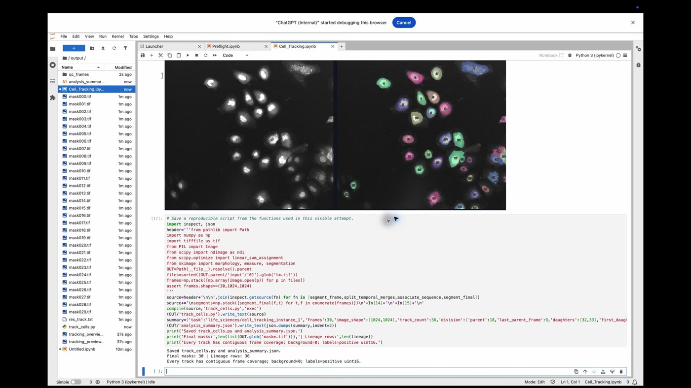</a>

出处： OpenAI · [发布页 · Cell-tracking workflow](https://openai.com/index/gpt-6-astra/)

Astra 在 JupyterLab 里搭建并运行显微镜细胞追踪工作流（分割掩膜 → 轨迹 / 谱系）。这是浓缩的官方电脑操控演示，不是期刊论文。

##### KiCad 电路板（`chip_design`）

<a href="https://openai.com/index/gpt-6-astra/">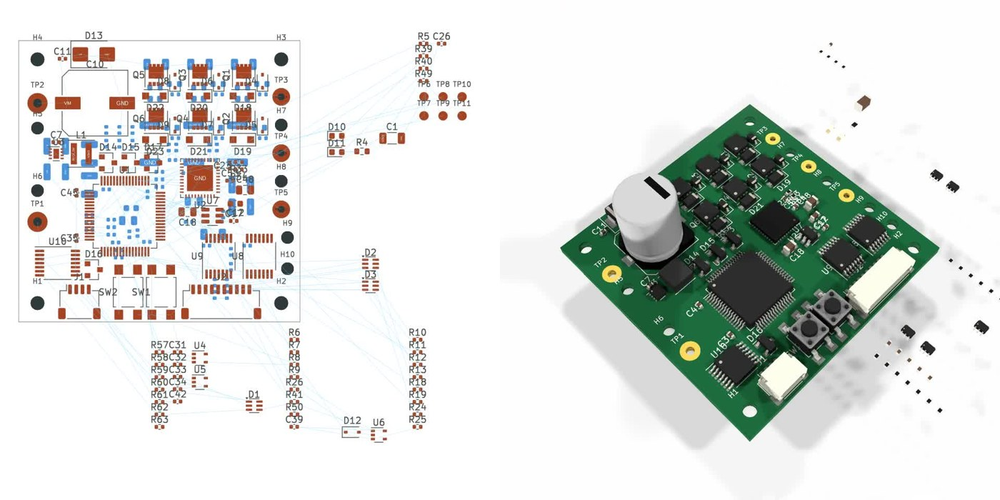</a>

出处： OpenAI · [发布页](https://openai.com/index/gpt-6-astra/) · 视频 `chip_design_no_captions_15s.mp4`

Astra 在 KiCad 里摆放元件并布线，做出可制造的 PCB（2D 布局 + 3D 电路板）。这是发布页的电子设计桌面，不是 MultiQC / 测序质控。

##### FreeCAD 五速变速箱

<a href="https://openai.com/index/gpt-6-astra/">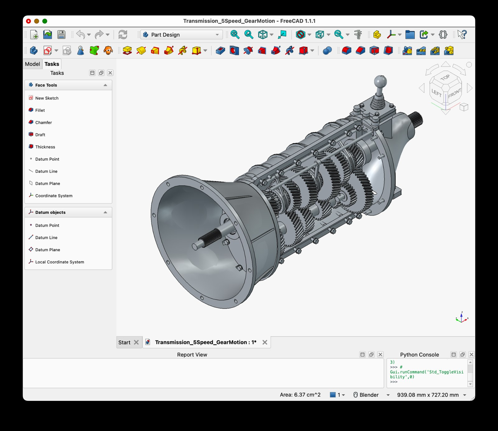</a>

出处： OpenAI · [发布页 · Car transmission](https://openai.com/index/gpt-6-astra/)

书面任务说明 → FreeCAD 里一套细化的五速变速箱概念设计。

##### 齿轮运动（FreeCAD → Blender）

<a href="https://openai.com/index/gpt-6-astra/">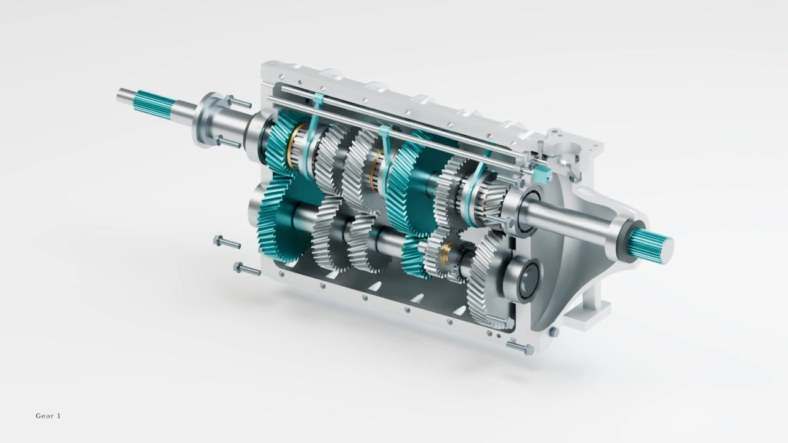</a>

出处： OpenAI · [发布页](https://openai.com/index/gpt-6-astra/) · 视频 `gear-motion.mp4`

同一条变速箱线：齿轮运转动画（在 FreeCAD 设计基础上用 Blender 接着做）。

##### Unity 城市场景

<a href="https://openai.com/index/gpt-6-astra/">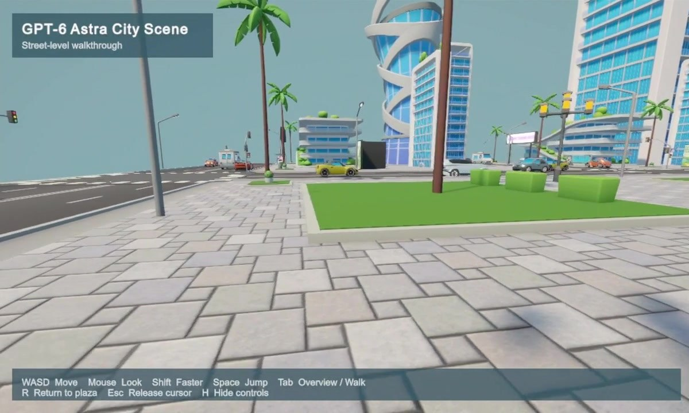</a>

出处： OpenAI · [发布页](https://openai.com/index/gpt-6-astra/) · 素材 `Unity-City-high-res.png`

在 Unity 里搭建的城市鸟瞰场景（官方电脑操控 / 游戏场景组装静帧）。

#### 3D 场景与建筑可视化

##### Solace 住宅（Blender → Unreal）

<a href="https://developers.openai.com/blog/architectural-visualization-with-astra">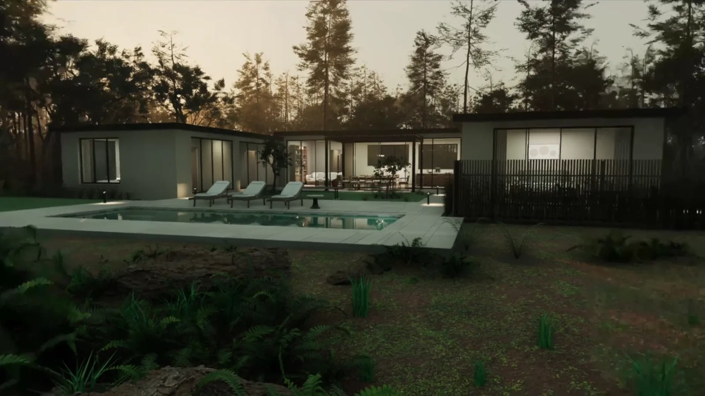</a>

<a href="https://developers.openai.com/blog/architectural-visualization-with-astra">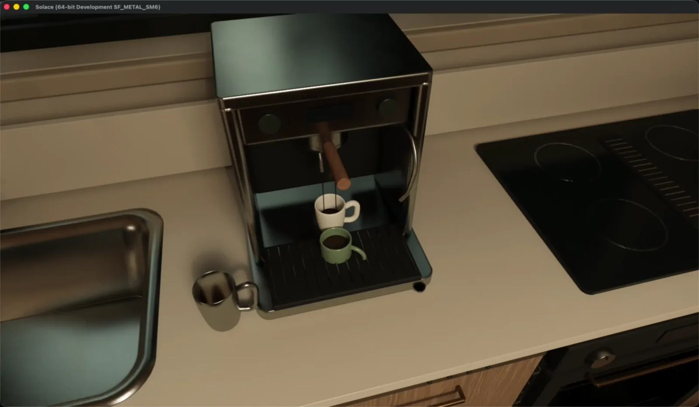</a>

出处： OpenAI Developers · [Architectural visualization with Astra](https://developers.openai.com/blog/architectural-visualization-with-astra)

由 Astra 驱动的建筑可视化流程：从 Blender 里的调研 / 建模一直到 Unreal 展示（Solace）。

##### HELIOS 戴森集能器

<a href="https://developers.openai.com/blog/architectural-visualization-with-astra">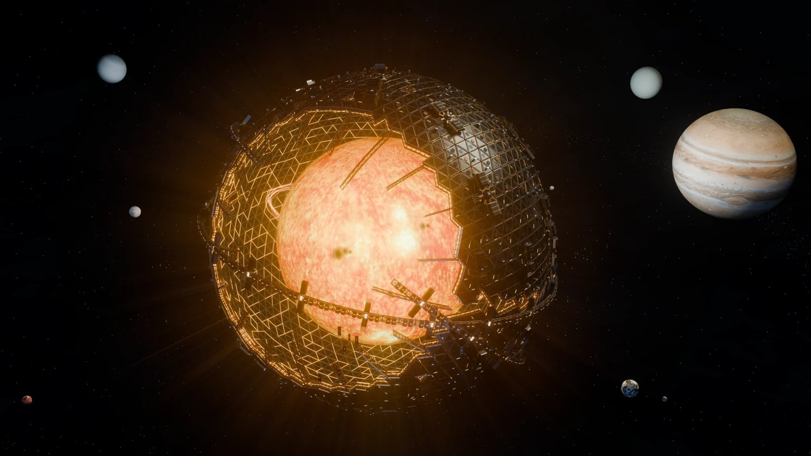</a>

出处： OpenAI Developers · 同一篇[建筑可视化](https://developers.openai.com/blog/architectural-visualization-with-astra)文章

同一篇官方建筑可视化文章里的概念作品（HELIOS / 戴森式集能器）。

##### Shipyard · AURELION-07 巡洋舰

<a href="https://developers.openai.com/blog/architectural-visualization-with-astra">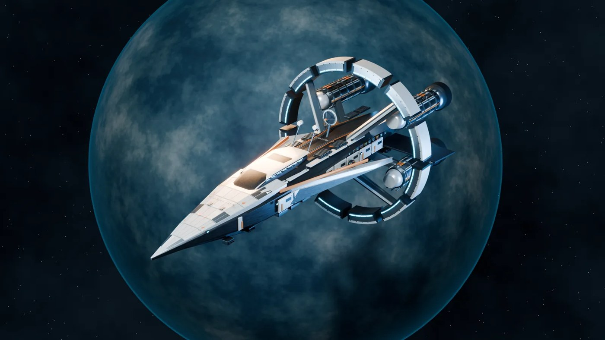</a>

出处： OpenAI Developers · [Architectural visualization with Astra](https://developers.openai.com/blog/architectural-visualization-with-astra)

Astra 在 Blender 里建出 AURELION-07（Shipyard 项目）：收窄船体、分段环、四台推进器，几何和材质均可编辑。

##### Giverny 水上花园

出处： OpenAI Developers · [Architectural visualization with Astra](https://developers.openai.com/blog/architectural-visualization-with-astra)

Astra 在同一篇官方建筑可视化文章里建出受莫奈 / Giverny 启发的花园场景（睡莲池、拱桥、植栽）。

#### 游戏

##### Void Explorer 飞船（Blender）

<a href="https://developers.openai.com/blog/how-to-build-games-with-astra">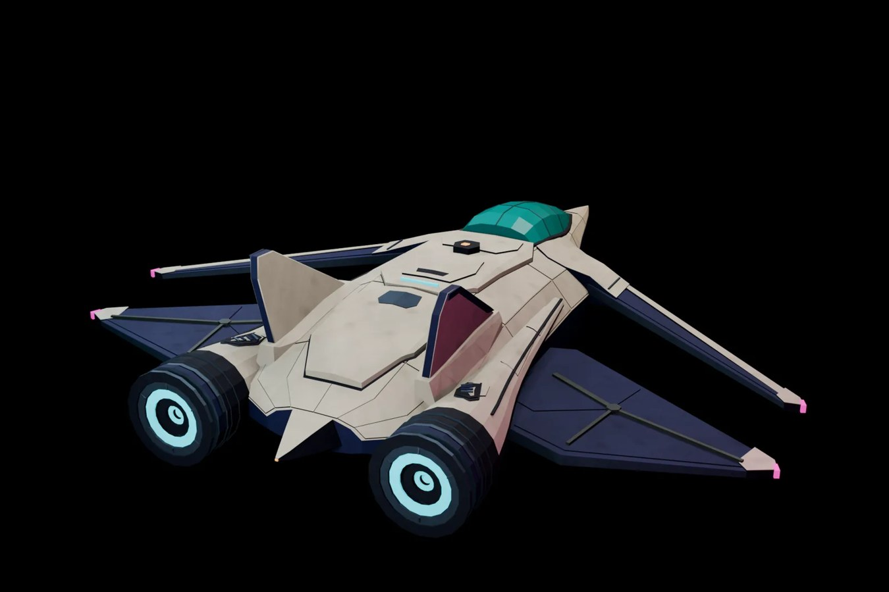</a>

出处： OpenAI Developers · [Building games with Astra](https://developers.openai.com/blog/how-to-build-games-with-astra)

Astra 为 Void Explorer 游戏在 Blender 里建出可编辑的飞船（AURORA：193 个网格 → 运行时资产）。

##### Sunwake 海面与船

<a href="https://developers.openai.com/blog/how-to-build-games-with-astra">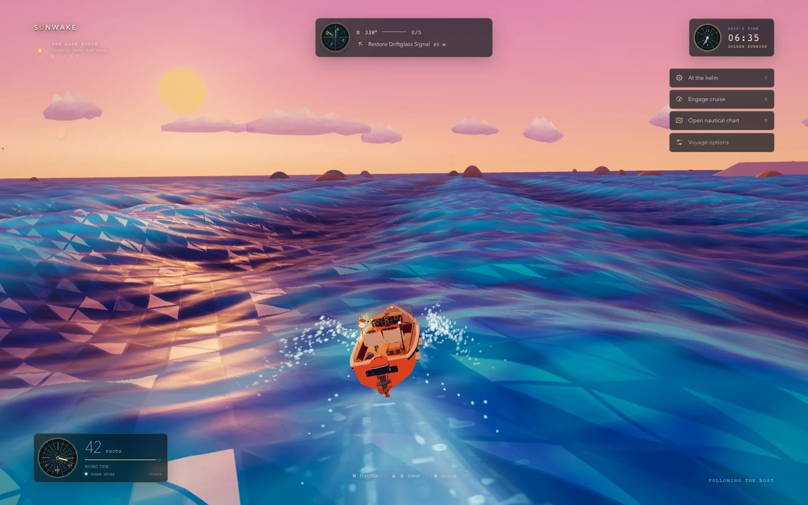</a>

出处： OpenAI Developers · 同一篇[游戏](https://developers.openai.com/blog/how-to-build-games-with-astra)文章

Astra 写了自定义的 Three.js 水面渲染器，并在 Blender 里做了船，一起放进 Sunwake。

##### Hollowflux 水系 RPG

<a href="https://developers.openai.com/blog/how-to-build-games-with-astra">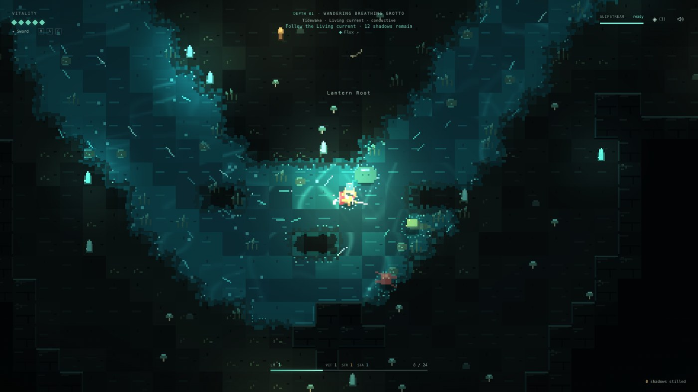</a>

出处： OpenAI Developers · [Building games with Astra](https://developers.openai.com/blog/how-to-build-games-with-astra)

Astra 迭代一款代码绘制的 2D 动作 RPG，核心是模拟的地下河（水体网格、水流、与战斗的耦合）。

#### Astra 不收录的内容

已移除或从未收录：

- 第三方 X / 博客上的「我用 Astra 做了……」演示
- 榜单表格（GeneBench、OSWorld、EEBench……）：是分数，不是作品
- 新闻 / 「冷静看待」类评论
- 错误的 MultiQC 归属（从来不是 Astra 做的项目；发布页的电子设计桌面是 KiCad）
- 十项 Lean 数学文章（OpenAI 原文写的是内部版 Astra，不能明确算作公开版 GPT-6 Astra 的产出）

更全的 Astra 链接合集：[helloianneo/awesome-gpt6-astra](https://github.com/helloianneo/awesome-gpt6-astra)。

---

## 新增条目

见 [CONTRIBUTING.md](CONTRIBUTING.md)。简单说：读过的一手来源、别人能打开的东西、一两句话且数字只取自来源、中英文 README 都加上，并在 [SOURCES_READ.tsv](SOURCES_READ.tsv) 里为用到的每个页面加一行。

---

**整理：** [Xuzhen Li](https://github.com/Xuzhen-Li) · [ORCID](https://orcid.org/0000-0003-3670-6657) · 编辑文字采用 [CC0 1.0](LICENSE)，详见 [NOTICE](NOTICE.md)。
